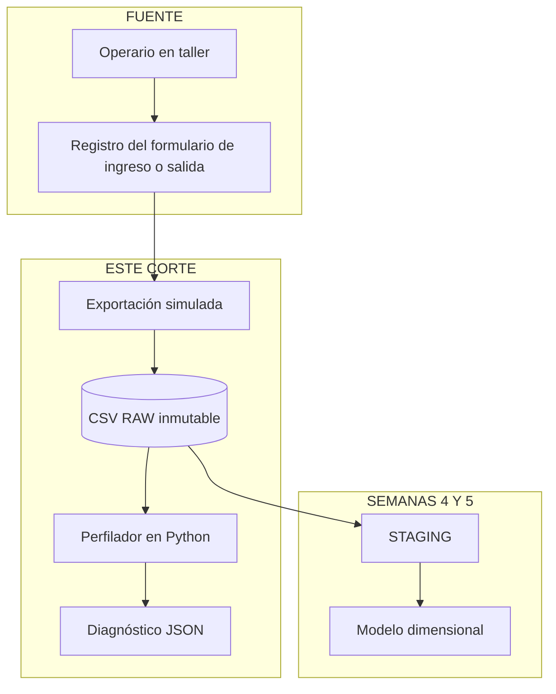
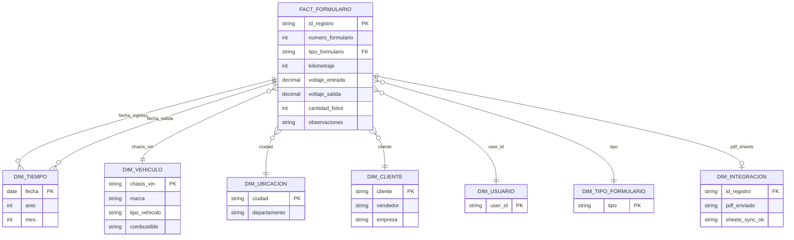

# Componente 3. Avance del proyecto integrador

**Curso:** Ingeniería de Datos  
**Docente:** Diana Marcela Toquica Rodriguez  
**Taller:** Primer Corte — Semana 3  
**Dominio del proyecto:** Formularios de ingreso y salida vehicular de Carrera Arango SAS  
**Repositorio:** Carrera Arango App (`carrera-arango-app`)  
**Fecha de entrega:** Semana 3  

**Equipo:**

| Integrante | Rol en el avance |
|------------|------------------|
| Daniel Alejandro Monroy | Viaje del dato y estructura del repositorio |
| Kevin Sebastian Soto | Archivo RAW, perfilamiento y scripts de datos |
| Samuel Eduardo Preciado | Contrato de datos, modelo conceptual, documentación y análisis |

---

## Introducción al avance

Este documento presenta el **avance de la semana 3** del proyecto integrador de Ingeniería de Datos, sobre los formularios de **ingreso y salida de vehículos** de Carrera Arango SAS. El repositorio de este corte se llama **Carrera Arango App**.

El avance no es el producto terminado del semestre. En esta versión el equipo:

1. Delimita el dominio y el viaje del dato hasta el archivo de trabajo.
2. Conserva un **archivo RAW simulado**, con errores de calidad puestos a propósito, sin modificarlo.
3. Perfila ese archivo y deja por escrito el contrato, el grano y el modelo conceptual.

El foco de la semana 3 es: **entender el dominio, proteger el dato original y definir la estructura conceptual** que guiará el resto del semestre. La limpieza hacia STAGING queda para las semanas 4 y 5.

---

## Tabla resumen de artefactos entregados

| Artefacto | Evidencia mínima entregada | Criterio de revisión | Sección |
|-----------|---------------------------|----------------------|---------|
| Problema y dominio | Descripción del proceso, alcance, consumidor y preguntas iniciales | Problema concreto y analizable con datos | §1 |
| Mapa del viaje del dato | Fuente, transformación, almacenamiento, consumidor, riesgos y responsable | Trazabilidad entre etapas | §2 |
| Repositorio y estructura | README, carpetas RAW/STAGING, evidencia por integrante | Proyecto comprensible sin explicación oral | §3 |
| Contrato y diccionario inicial | ≥5 campos con tipo, formato, regla, ejemplo y acción ante error | Reglas verificables | §4 |
| Archivo RAW y diagnóstico | Fuente original conservada y perfilamiento básico | Archivo original no modificado | §5 |
| Preguntas analíticas y grano | Preguntas, evento central y unidad de análisis | Grano inequívoco | §6 |
| Modelo conceptual inicial | Hechos, dimensiones y relaciones principales | Responde preguntas analíticas | §7 |
| Riesgos y pendientes | Lista priorizada de calidad, disponibilidad y decisiones | Orienta semanas 4 y 5 | §8 |

---

## §1. Problema y dominio

### 1.1 Descripción del proceso de negocio

Carrera Arango SAS es una empresa del sector automotriz que recibe vehículos en taller para adecuación, instalación de componentes y verificación de estado. Antes de la digitalización, el **registro de ingreso y salida** se realizaba de forma manual o fragmentada, lo que dificultaba:

- Consolidar checklist de inspección (interior, motor, vidrios, carrocería, llantas).
- Adjuntar evidencia fotográfica y firmas de entrega, recepción y verificación.
- Entregar oportunamente el acta al cliente.
- Consultar históricamente qué ocurrió con un vehículo identificado por **chasis/VIN**.

**Carrera Arango App**, en este corte, estudia ese dominio. El dato de trabajo es un CSV que simula una exportación desordenada de esos formularios. El código entregado lee ese archivo y escribe un diagnóstico. No corrige filas y no llena STAGING.

### 1.2 Alcance del dominio de datos (semestre — corte 1)

| Incluye | No incluye (por ahora) |
|---------|------------------------|
| Formularios de ingreso y salida vehicular | Sistema de inventario por VIN |
| Datos generales: ciudad, marca, chasis, km, cliente | Tablero de inventario |
| Inspección estructurada (checklist booleano y numérico) | Integración con un ERP |
| Fotos, firmas, observaciones | Explotación analítica avanzada |
| Metadatos del envío del acta y de la copia de consulta | |

### 1.3 Consumidores del dato

| Consumidor | Qué necesita del dato | Dónde queda en este corte |
|------------|----------------------|---------------------------|
| Operario de taller | Registrar ingreso y salida | Formulario del proceso; esta versión no lo captura |
| Logística / administración | Consultar formularios y evidencias | Fuera del código de la semana 3 |
| Cliente final | Recibir el acta del vehículo | Fuera del código de la semana 3 |
| Equipo de datos (este curso) | Analizar calidad, volumen e inconsistencias | CSV RAW y el diagnóstico JSON |
| Auditoría interna | Saber quién registró y cuándo | Columnas `user_id` y `created_at` del RAW |

### 1.4 Preguntas iniciales del dominio

1. ¿Cuántos formularios de ingreso y salida se registran por periodo y por ciudad?
2. ¿Qué porcentaje de registros tiene VIN/chasis inválido o incompleto?
3. ¿Cuál es el tiempo promedio entre ingreso y salida de un mismo `numero_formulario`?
4. ¿Qué marcas y tipos de vehículo concentran más observaciones o novedades?
5. ¿Qué proporción de actas o de copias de consulta queda pendiente?

Estas preguntas son **analizables con datos** y orientan el modelado de la sección 6. El perfilador de esta versión todavía no las calcula sobre datos limpios.

---

## §2. Mapa del viaje del dato

### 2.1 Diagrama del corte



### 2.2 Tabla del viaje del dato (etapa por etapa)

| Etapa | Descripción | Tecnología / artefacto | Responsable | Dato de entrada | Dato de salida | Riesgo principal |
|-------|-------------|------------------------|-------------|-----------------|----------------|------------------|
| **1. Fuente** | El operario registra el ingreso o la salida del vehículo | Formulario del proceso | Operario / logística | Evento en el taller | Datos del formulario | Error al digitar VIN o kilometraje |
| **2. Exportación simulada** | El curso trabaja una copia desordenada, no un archivo ya corregido | CSV en `data/raw/` | Equipo de datos | Esquema de los formularios | 10 000 filas | Errores de calidad puestos a propósito |
| **3. Conservación** | El RAW no se edita | `data/raw/README.md` | Equipo de datos | CSV | El mismo CSV | Perder la trazabilidad si alguien lo sobrescribe |
| **4. Perfilamiento** | Conteo de problemas de calidad, sin reparar filas | `scripts/profile_raw_dataset.py` | Kevin Sebastian Soto | CSV RAW | JSON de diagnóstico | Tomar el 26,15 % de JSON como si fuera todo el archivo: es una muestra de 2 000 celdas |
| **5. Staging** | Limpieza pendiente | `data/staging/` | Equipo de datos | CSV RAW | Todavía no hay archivo | Tratar la carpeta vacía como un fallo de esta versión |

### 2.3 Trazabilidad entre etapas

Cada fila del RAW mantiene este encadenamiento:

```
id_registro → numero_formulario + tipo_formulario → chasis_vin
            → user_id
            → created_at
            → pdf_enviado / sheets_sync_ok
```

El par ingreso y salida se reconoce por `numero_formulario`. En este corte el perfilador no une esas dos filas: solo cuenta problemas de calidad.

### 2.4 Qué ejecuta el código de esta versión

1. Resuelve la ruta del CSV a partir de la ubicación del script.
2. Lee las 10 000 filas con pandas.
3. Aplica las cuatro reglas de `scripts/reglas_calidad.py`.
4. Escribe `entregables/diagnostico_raw_perfilamiento.json`.
5. No abre el CSV en modo escritura y no crea archivos en `data/staging/`.

**Evidencia en el repositorio:** `scripts/profile_raw_dataset.py`, `scripts/reglas_calidad.py` y `tests/test_reglas_calidad.py`.

---

## §3. Repositorio y estructura

### 3.1 Estructura de carpetas

```
carrera-arango-app/
├── README.md
├── requirements.txt
├── data/
│   ├── raw/                  # INMUTABLE
│   └── staging/              # vacía hasta las semanas 4 y 5
├── scripts/
│   ├── reglas_calidad.py
│   └── profile_raw_dataset.py
├── tests/
│   └── test_reglas_calidad.py
└── entregables/
    ├── componente-3-avance-proyecto-integrador.md
    └── diagnostico_raw_perfilamiento.json
```

### 3.2 Capas de datos de este corte

| Capa | Ruta | Estado | Descripción |
|------|------|--------|-------------|
| **RAW** | `data/raw/*.csv` | Entregada (10 000 filas) | Exportación simulada; **no se modifica** |
| **Diagnóstico** | `entregables/diagnostico_raw_perfilamiento.json` | Entregado | Conteos de calidad, no una copia corregida |
| **STAGING / SILVER** | `data/staging/` | Vacía (sem. 4–5) | Datos limpios y rechazados, todavía no |
| **ANALÍTICA / GOLD** | Por definir | Pendiente | Modelo dimensional de la sección 7 |

### 3.3 Evidencia por integrante

| Integrante | Artefacto | Ruta / evidencia | Qué demuestra |
|------------|-----------|------------------|---------------|
| Daniel Alejandro Monroy | Viaje del dato y estructura | `README.md`, `data/raw/`, `data/staging/` | Organización del repositorio y separación del dato original |
| Kevin Sebastian Soto | RAW y perfilamiento | `data/raw/dataset_sucio_formularios_vehiculos_carrera_arango.csv`, `scripts/profile_raw_dataset.py`, `entregables/diagnostico_raw_perfilamiento.json` | Diagnóstico sin alterar el RAW |
| Samuel Eduardo Preciado | Contrato y diccionario | §4 de este documento | Reglas verificables de calidad |
| Samuel Eduardo Preciado | Modelo conceptual y grano | §6 y §7 de este documento | Preguntas analíticas y dimensiones |

### 3.4 README

El repositorio incluye:

- `README.md` — cómo ejecutar el perfilador de Carrera Arango App.
- `data/raw/README.md` — el CSV no se edita.
- `data/staging/README.md` — la carpeta queda vacía hasta las semanas 4 y 5.

### 3.5 Cómo mostrar las evidencias del repositorio en el informe (sin duplicar archivos)

El taller indica: *«No se deben duplicar archivos si ya están versionados en el repositorio; en el informe basta con referenciarlos y aportar la evidencia necesaria»*. Por eso en el **documento Word** se hace lo siguiente:

| Qué pide el taller | Dónde está en el repo | Cómo se cita en el informe Word |
|--------------------|----------------------|--------------------------------|
| Carpetas RAW / STAGING | `data/raw/` y `data/staging/` | Árbol de §3.1 y captura del explorador de archivos |
| README del proyecto | `README.md` | Párrafo de §3.4 |
| Archivo RAW (original) | `data/raw/dataset_sucio_formularios_vehiculos_carrera_arango.csv` | Tabla §5.1 con nombre, registros y columnas; **no pegar el CSV completo** |
| Diagnóstico / perfilamiento | `entregables/diagnostico_raw_perfilamiento.json` | Tabla de métricas §5.2; el JSON queda en el repo |
| Scripts reproducibles | `scripts/profile_raw_dataset.py`, `scripts/reglas_calidad.py`, `tests/test_reglas_calidad.py` | Comandos del anexo B |

**Texto para el informe:**

> *Las evidencias (archivo RAW, scripts, JSON de diagnóstico y README) están en el repositorio Carrera Arango App. Este documento resume los hallazgos. La fuente en `data/raw/` no fue modificada, conforme a `data/raw/README.md`.*

**Capturas recomendadas para adjuntar en Word:**

1. Explorador de archivos con `data/raw/` y el CSV.
2. Primeras filas del CSV, como muestra, no como anexo completo.
3. Salida en consola de `profile_raw_dataset.py`.
4. Estructura de carpetas del repositorio.

**En la entrega:** subir el informe y el repositorio Carrera Arango App.

---

## §4. Contrato y diccionario inicial de datos

### 4.1 Diferencia contrato vs. diccionario

- **Diccionario de datos:** describe qué significa cada campo (semántica).
- **Contrato de datos:** define además tipo, formato, reglas de validación y **acción ante error** — es verificable automáticamente en el pipeline ETL.

### 4.2 Contrato inicial — campos críticos (≥5)

| Campo | Tipo | Formato | Regla de validación | Ejemplo válido | Acción ante error |
|-------|------|---------|---------------------|----------------|-------------------|
| `id_registro` | UUID | `xxxxxxxx-xxxx-xxxx-xxxx-xxxxxxxxxxxx` | No nulo; único en el dataset | `d15832d6-a189-baa8-c85c-4b5d28434c5b` | Rechazar registro → `rejected/id_invalido.csv` |
| `numero_formulario` | Entero positivo | Dígitos sin sufijos | `>= 1`; entero; sin texto adicional | `284177` | Intentar extraer dígitos; si falla → cuarentena |
| `tipo_formulario` | Categoría | `ingreso` \| `salida` | Valor en dominio cerrado (case-insensitive, sin espacios) | `ingreso` | Normalizar (`trim`, minúsculas, quitar tildes); si no mapea → rechazar |
| `fecha_ingreso` | Fecha | `YYYY-MM-DD` | Fecha parseable; no futura >1 día; no `SIN_FECHA` | `2025-08-20` | Intentar parseo multi-formato (`DD/MM/YYYY`); si falla → `null` + flag `fecha_ingreso_invalida` |
| `chasis_vin` | Texto (VIN) | 17 caracteres alfanuméricos | Longitud = 17; charset `A-H,J-N,P,R-Z,0-9`; no `SIN_CHASIS` ni `DUPLICADO_VIN` | `50R35SSC07K920VRZ` | Rechazar o enviar a revisión manual según política |
| `kilometraje` | Entero | Kilómetros ≥ 0 | Numérico entero; `0 <= km <= 999999` | `434723` | Si texto (`Desconocido`) → `null`; si negativo → valor absoluto o rechazo |
| `voltaje_bateria_entrada` | Decimal | `NN.N` (1 decimal) | `10.0 <= v <= 15.0` | `12.6` | Extraer número con regex; si no parsea → `null` |
| `email_destino` | Email | RFC básico | Contiene `@` y dominio; no vacío para envío PDF | `ana.arango@carrera-arango.com` | Marcar `pdf_no_enviable`; no bloquear persistencia |
| `data_json_supabase` | JSON | Objeto JSON válido | `json.loads()` exitoso; contiene `datosGenerales.chasis` | `{"id":"...","datosGenerales":{...}}` | Guardar raw en columna backup; intentar reparación; si falla → usar columnas planas |

### 4.3 Diccionario resumido — columnas del RAW

| Columna | Descripción de negocio |
|---------|------------------------|
| `id_registro` | Identificador único del formulario (equivale a `formularios.id`) |
| `user_id` | Identificador de quien capturó el registro |
| `numero_formulario` | Número secuencial; vincula ingreso con su salida |
| `tipo_formulario` | `ingreso` o `salida` |
| `email_destino` | Destinatario del PDF automático |
| `fecha_ingreso` / `fecha_salida` | Fechas de operación en taller |
| `ciudad` / `departamento` | Ubicación del taller / operación |
| `marca` / `chasis_vin` | Identificación del vehículo |
| `kilometraje` | Km al momento del formulario |
| `cliente` / `vendedor` / `empresa` | Actores comerciales |
| `combustible` | Tipo de combustible del vehículo |
| `voltaje_bateria_entrada` / `voltaje_bateria_salida` | Medición de batería (medición del formulario) |
| `firma_*` | Nombre y cédula de quien entrega, recibe y verifica |
| `cantidad_fotos` | Número de evidencias fotográficas |
| `pdf_enviado` / `sheets_sync_ok` | Estado de integraciones |
| `observaciones` | Novedades libres del vehículo |
| `data_json_supabase` | Representación JSON del registro (texto JSON del registro) |

### 4.4 Dimensiones de calidad aplicadas al dominio

| Dimensión | Campo ejemplo | Problema detectado en RAW |
|-----------|---------------|---------------------------|
| **Completitud** | `fecha_salida` | ~49,6% vacío (esperable en ingresos) |
| **Validez** | `fecha_ingreso` | ~9,7% con formato inválido o `SIN_FECHA` |
| **Unicidad** | `id_registro` | 183 duplicados en muestra de 10 000 |
| **Consistencia** | `marca` / `ciudad` | Variantes `HYUNDAI` vs `hyundai`; `Bogotá` vs `Bogota` |
| **Oportunidad** | `pdf_enviado` | Flags inconsistentes (`true`, `SI`, `1`) |

---

## §5. Archivo RAW y diagnóstico

### 5.1 Fuente RAW conservada

| Atributo | Valor |
|----------|-------|
| **Archivo** | `data/raw/dataset_sucio_formularios_vehiculos_carrera_arango.csv` |
| **Registros** | 10 000 |
| **Columnas** | 34 |
| **Tamaño** | ~7,0 MB |
| **Regla** | **El archivo RAW no se modifica** — ver `data/raw/README.md` |

> **Nota:** Este corte entrega la muestra de 10 000 registros. El archivo no se regenera ni se edita.

### 5.2 Perfilamiento básico (evidencia verificable)

Resultado de `python3 scripts/profile_raw_dataset.py`, ejecutado desde la raíz del repositorio:

| Métrica | Resultado |
|---------|-----------|
| Registros analizados | 10 000 |
| Columnas | 34 |
| `fecha_ingreso` inválida | 9,7% |
| `kilometraje` inválido | 4,47% |
| `chasis_vin` inválido | 5,62% |
| `id_registro` duplicados | 183 |
| JSON corrupto (muestra 2 000 filas) | 26,15% |
| `id_registro` nulos | 0,86% |

**Distribución `tipo_formulario` (con ruido):**

| Valor | Cantidad |
|-------|----------|
| `ingreso` | 4 921 |
| `salida` | 4 804 |
| `INGRESO`, `SALIDA`, ` salida`, `salída`, etc. | 275 (combinados) |

**Archivo completo de diagnóstico:** `entregables/diagnostico_raw_perfilamiento.json`

### 5.3 Ejemplos de registros problemáticos (sin alterar RAW)

**Caso A — Kilometraje negativo y JSON truncado:**

```
id_registro: d149b18b-a9cd-1fbb-9ff1-0ba04b03e925
kilometraje: -438049
data_json_supabase: {"id": "...", "datosGenerales": {
```

**Caso B — Tipo de formulario con typo:**

```
tipo_formulario: salída
```

**Caso C — Marca inconsistente:**

```
marca: hyundai   (vs HYUNDAI en otros registros del mismo dataset)
```

### 5.4 Comando de reproducción del diagnóstico

```bash
python3 scripts/profile_raw_dataset.py
```

El script **solo lee** el RAW; no escribe sobre él.

---

## §6. Preguntas analíticas y grano

### 6.1 Evento central

> **Registro de un formulario de inspección vehicular** (ingreso o salida) asociado a un vehículo identificado por `chasis_vin` y a un `numero_formulario`.

### 6.2 Grano (unidad de análisis)

> **Una fila = un formulario único identificado por `id_registro` (UUID), de tipo `ingreso` o `salida`, en una fecha y ciudad determinadas.**

| Decisión de grano | Justificación |
|-------------------|---------------|
| No usar solo `numero_formulario` | Un número puede tener ingreso Y salida (dos eventos) |
| No usar `chasis_vin` solo | Un vehículo puede tener múltiples visitas al taller |
| Usar `id_registro` | Identifica cada formulario dentro del archivo |

**Grano compuesto para análisis de ciclo ingreso→salida:**

> Par (`numero_formulario`, `chasis_vin`) — permite medir tiempo entre ingreso y salida del mismo caso.

### 6.3 Preguntas analíticas formales

| # | Pregunta analítica | Métrica | Dimensión(es) |
|---|-------------------|---------|---------------|
| PA1 | ¿Cuántos formularios se registran por mes y por tipo? | `COUNT(id_registro)` | Tiempo, Tipo formulario |
| PA2 | ¿Qué ciudades concentran más ingresos? | `COUNT` filtrado `tipo=ingreso` | Geografía |
| PA3 | ¿Qué porcentaje de registros tiene VIN inválido? | `COUNT` inválidos / total | Calidad, Marca |
| PA4 | ¿Cuál es el tiempo medio entre ingreso y salida? | `AVG(fecha_salida - fecha_ingreso)` | Tiempo, Cliente |
| PA5 | ¿Qué marcas tienen mayor kilometraje promedio al ingreso? | `AVG(kilometraje)` | Vehículo |
| PA6 | ¿Cuántos registros fallaron en PDF o Sheets? | `COUNT` donde flags inválidos | Integración |

### 6.4 Verificación de grano inequívoco

- Si dos filas comparten `numero_formulario`, deben diferir en `tipo_formulario` (ingreso vs salida), no duplicar el mismo tipo salvo error de calidad (detectable).
- `id_registro` duplicado = **violación de grano** → 183 casos en muestra RAW para tratar en STAGING.

---

## §7. Modelo conceptual inicial

### 7.1 Esquema entidad-relación (hechos y dimensiones)



### 7.2 Tabla de hechos

**Hecho:** `FACT_FORMULARIO` (un registro = un formulario de inspección)

| Atributo | Tipo | Descripción |
|----------|------|-------------|
| `id_registro` | PK | Identificador del evento |
| `numero_formulario` | Degenerado | Número operativo compartido ingreso/salida |
| `kilometraje` | Medida | Km reportado |
| `voltaje_bateria_entrada` | Medida | Voltaje batería al ingreso |
| `voltaje_bateria_salida` | Medida | Voltaje batería a la salida |
| `cantidad_fotos` | Medida | Conteo de evidencias |
| `observaciones` | Texto | Novedades (puede alimentar análisis cualitativo) |

### 7.3 Tabla de dimensiones

| Dimensión | Clave | Atributos | Responde preguntas |
|-----------|-------|-----------|-------------------|
| `DIM_TIEMPO` | `fecha` | año, mes, trimestre | PA1, PA4 |
| `DIM_VEHICULO` | `chasis_vin` | marca, tipo_vehiculo, combustible | PA3, PA5 |
| `DIM_UBICACION` | `ciudad` | departamento | PA2 |
| `DIM_CLIENTE` | `cliente` | vendedor, empresa | PA4, segmentación |
| `DIM_USUARIO` | `user_id` | (quien registró el formulario) | Trazabilidad / auditoría |
| `DIM_TIPO_FORMULARIO` | `tipo` | ingreso / salida | PA1 |
| `DIM_INTEGRACION` | `id_registro` | pdf_enviado, sheets_sync_ok | PA6 |

### 7.4 Relación con preguntas analíticas

| Pregunta | Tabla(s) utilizada(s) |
|----------|----------------------|
| PA1 | `FACT_FORMULARIO` + `DIM_TIEMPO` + `DIM_TIPO_FORMULARIO` |
| PA2 | `FACT_FORMULARIO` + `DIM_UBICACION` |
| PA3 | `FACT_FORMULARIO` + `DIM_VEHICULO` + reglas de calidad |
| PA4 | Self-join por `numero_formulario` + `DIM_TIEMPO` |
| PA5 | `FACT_FORMULARIO` + `DIM_VEHICULO` |
| PA6 | `FACT_FORMULARIO` + `DIM_INTEGRACION` |

---

## §8. Riesgos y pendientes

### 8.1 Lista priorizada

| Prioridad | Riesgo / pendiente | Impacto | Mitigación planificada | Semana |
|-----------|-------------------|---------|------------------------|--------|
| **Alta** | JSON corrupto en `data_json_supabase` (~26%) | Pérdida de campos anidados en ETL | Priorizar columnas planas; JSON como enriquecimiento opcional | 4 |
| **Alta** | Duplicados en `id_registro` | Violación de grano | Deduplicación con regla: conservar más reciente por `created_at` | 4 |
| **Alta** | Inconsistencia `tipo_formulario` | Conteos incorrectos PA1 | Normalización a dominio `ingreso`/`salida` | 4 |
| **Media** | Fechas multi-formato | Errores en PA4 (tiempo ingreso→salida) | Parser centralizado de fechas | 4 |
| **Media** | VIN inválido (~5,6%) | PA3 y join con dimensión vehículo | Cuarentena + reporte de calidad | 4–5 |
| **Media** | Capa STAGING vacía | Sin pipeline reproducible | Implementar ETL RAW → STAGING | 4 |
| **Baja** | Muestra RAW 10K vs 1,6M objetivo | Escalabilidad no probada | Generar volumen completo si el equipo lo requiere | 5 |

### 8.2 Decisiones por resolver (semanas 4 y 5)

1. ¿Rechazar o reparar registros con VIN inválido?
2. ¿Usar Parquet además de CSV en STAGING?
3. ¿Guardar SILVER solo en archivo o también en una base local?
4. ¿Cómo medir PA4 cuando `fecha_salida` está vacía en ingresos puros?

### 8.3 Tareas concretas siguientes

- [ ] Script ETL `raw_to_staging.py` con reglas del contrato §4.
- [ ] Archivo `formularios_rechazados.csv` con motivo de rechazo.
- [ ] Validación automática de las 9 reglas del contrato.
- [ ] Vista SQL o notebook con PA1 y PA3 sobre STAGING limpio.

---

## Reporte de actividades del equipo

| Artefacto / actividad | Participante(s) | Fecha compromiso | Fecha entrega | Evidencia / enlace | Estado |
|-----------------------|-----------------|------------------|---------------|-------------------|--------|
| Mapa del viaje del dato | Daniel Alejandro Monroy | Sem. 2 | Sem. 3 | §2 de este documento | Completado |
| Archivo RAW y regla de inmutabilidad | Kevin Sebastian Soto | Sem. 3 | Sem. 3 | `data/raw/`, `data/raw/README.md` | Completado |
| Perfilamiento básico RAW | Kevin Sebastian Soto | Sem. 3 | Sem. 3 | `scripts/profile_raw_dataset.py`, `entregables/diagnostico_raw_perfilamiento.json` | Completado |
| Contrato y diccionario | Samuel Eduardo Preciado | Sem. 3 | Sem. 3 | §4 de este documento | Completado |
| Preguntas analíticas y grano | Samuel Eduardo Preciado | Sem. 3 | Sem. 3 | §6 de este documento | Completado |
| Modelo conceptual inicial | Samuel Eduardo Preciado | Sem. 3 | Sem. 3 | §7 de este documento | Completado |
| Estructura RAW/STAGING | Daniel Alejandro Monroy | Sem. 3 | Sem. 3 | Raíz de `carrera-arango-app/` | Completado |
| Documento Componente 3 | Los tres integrantes | Sem. 3 | Sem. 3 | `entregables/componente-3-avance-proyecto-integrador.docx` | Completado |
| Pipeline ETL a STAGING | Kevin Sebastian Soto, Samuel Eduardo Preciado | Sem. 4 | Pendiente | `data/staging/` | Pendiente |

---

## Conclusiones técnicas del avance (Componente 3)

### Conclusión grupal

El equipo dejó un avance verificable de la semana 3 de **Carrera Arango App**: el dominio de los formularios de Carrera Arango SAS, un RAW inmutable, el perfilamiento, el contrato, el grano, las preguntas PA1–PA6 y el modelo conceptual. El ETL no está hecho. `data/staging/` sigue vacía a propósito.

Separar `data/raw/` de `data/staging/` protege la trazabilidad y cumple la regla del taller de no alterar el dato original.

### Conclusión individual — Daniel Alejandro Monroy

Documenté el viaje del dato desde el registro en el taller hasta el CSV de trabajo y organicé el repositorio en RAW y STAGING. El diagnóstico queda separado del archivo original.

### Conclusión individual — Kevin Sebastian Soto

Dejé el RAW sin modificar y el script de perfilamiento, que solo lee. Los hallazgos (fechas inválidas 9,7 %, kilometraje inválido 4,47 %, VIN inválido 5,62 %, 183 filas con id repetido y 26,15 % de JSON corrupto en la muestra de 2 000 celdas) marcan el trabajo de las semanas 4 y 5.

### Conclusión individual — Samuel Eduardo Preciado

Definí el contrato de datos, el grano del evento (`id_registro`), las preguntas analíticas PA1–PA6 y el modelo conceptual de hechos y dimensiones. Esas reglas todavía no están programadas en el perfilador: orientan el ETL de las semanas siguientes.

---

## Referencias (APA 7)

Kimball, R., & Ross, M. (2013). *The data warehouse toolkit: The definitive guide to dimensional modeling* (3rd ed.). Wiley.

Instituto Colombiano de Normas Técnicas y Certificación [ICONTEC]. (2020). *NTC ISO 8000-8: Gestión de calidad de datos*. (Referencia para dimensiones de calidad de datos).

Python Software Foundation. (2024). *pandas: Powerful data structures for data analysis*. https://pandas.pydata.org/

---

## Anexos

### Anexo A — Rutas de evidencia en el repositorio

| Evidencia | Ruta |
|-----------|------|
| Documento Componente 3 | `entregables/componente-3-avance-proyecto-integrador.docx` |
| RAW | `data/raw/dataset_sucio_formularios_vehiculos_carrera_arango.csv` |
| Diagnóstico JSON | `entregables/diagnostico_raw_perfilamiento.json` |
| Reglas de calidad | `scripts/reglas_calidad.py` |
| Perfilamiento | `scripts/profile_raw_dataset.py` |
| Pruebas | `tests/test_reglas_calidad.py` |

### Anexo B — Comandos de este corte

Desde la raíz del repositorio:

```bash
python3 -m unittest tests/test_reglas_calidad.py
python3 scripts/profile_raw_dataset.py
```

El perfilador **solo lee** el RAW. No lo regenera y no escribe en `data/staging/`.

---

*Documento del Taller Corte 1 — Componente 3. Avance del proyecto integrador. Ingeniería de Datos. Repositorio: Carrera Arango App.*
